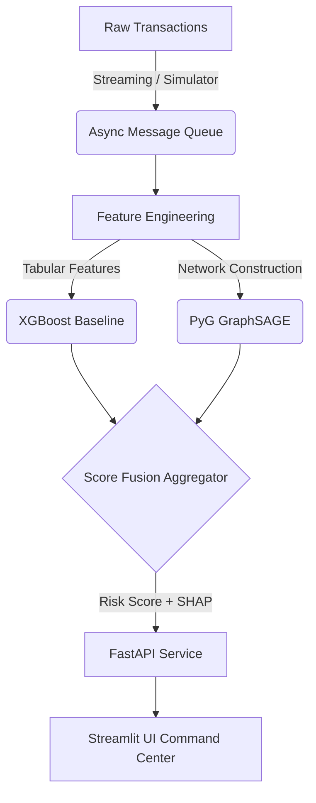

# SentinelGraph 🛡️ — Graph-Augmented Real-Time Fraud & AML Detection

[](https://www.python.org/)
[](https://xgboost.readthedocs.io/)
[](https://pyg.org/)
[](https://fastapi.tiangolo.com/)
[](https://mlflow.org/)

> A transaction monitoring and Anti-Money Laundering (AML) system. SentinelGraph combines a classical gradient-boosted tabular baseline (XGBoost) with a **GraphSAGE Graph Neural Network (GNN) trained on the transaction network**, catching coordinated laundering rings, circular splits, and structuring patterns that bypass traditional row-level scanners.

[](https://sentinelgraph.streamlit.app/)


---

## 🏛️ System Architecture

SentinelGraph uses a streaming-first architecture where transactions are pushed through an asynchronous processing queue, updating a dynamic NetworkX graph while dual classifiers score the activity in parallel.



### Key Features

1. **Dual Explainability:** Tabular SHAP explanations combined with localized subgraphs to show relational patterns (cycles, fan-in/fan-out).
2. **Streaming Pipeline:** An `asyncio`-powered producer-consumer pipeline simulating real-time Kafka transaction ingest.
3. **Automated Drift Retraining:** Integrated **Evidently AI** data/concept drift monitoring that triggers model retraining pipelines when feature distributions shift.
4. **Interactive Analyst Dashboard:** A rich Streamlit interface designed for compliance teams to review flagged accounts, investigate subgraph structures, and inspect SHAP contributions.

---

## 🧬 GraphSAGE Advantage

Unlike GCNs, GraphSAGE relies on **neighborhood sampling** to generate representations inductively. This allows the GNN classifier to score incoming transactions and evaluate new accounts in real time without retraining the entire graph.

| Property | GCN | GraphSAGE (SentinelGraph) |
|:---|:---|:---|
| **Inductive?** | ❌ Transductive (Cannot generalize to new nodes) | ✅ Inductive (Can evaluate unseen accounts) |
| **Scalable?** | ❌ Full graph needed | ✅ Neighborhood sampling |
| **Real-time scoring** | ❌ Requires global retraining | ✅ Generates embeddings on local neighborhoods |

---

## 📐 Mathematical Formulations

To provide a rigorous understanding of SentinelGraph's dual-engine detection, below are the formal mathematical formulations for both the **GraphSAGE GNN** and **XGBoost** components, as well as the **Score Fusion** mechanism.

### 1. GraphSAGE (Graph Sample and Aggregate) Formulation

SentinelGraph models financial entities as a directed transaction graph $\mathcal{G} = (\mathcal{V}, \mathcal{E})$, where nodes $v \in \mathcal{V}$ represent accounts/customers with feature vectors $\mathbf{x}_v \in \mathbb{R}^{d_v}$, and directed edges $e_{uv} = (u, v) \in \mathcal{E}$ represent transactions from account $u$ to account $v$ with edge attributes $\mathbf{e}_{uv} \in \mathbb{R}^{d_e}$.

#### A. Neighborhood Aggregation ($k$-th Layer)
For each node $v$, GraphSAGE samples a uniform local neighborhood $\mathcal{N}(v) \subset \mathcal{V}$. At layer $k \in \{1, \dots, K\}$ with base node features $\mathbf{h}_v^{(0)} = \mathbf{x}_v$, the neighborhood information is aggregated using a mean aggregator:

$$\mathbf{h}_{\mathcal{N}(v)}^{(k)} = \text{AGGREGATE}_k \left( \left\{ \mathbf{h}_u^{(k-1)}, \, \forall u \in \mathcal{N}(v) \right\} \right) = \frac{1}{|\mathcal{N}(v)|} \sum_{u \in \mathcal{N}(v)} \mathbf{h}_u^{(k-1)}$$

#### B. Node State Update & Feature Concatenation
The target node's representation from the previous step is combined with the aggregated neighborhood vector via learned transformation weights and non-linear activation $\sigma(\cdot)$ (ReLU):

$$\mathbf{h}_v^{(k)} = \sigma \left( \mathbf{W}_{\text{self}}^{(k)} \mathbf{h}_v^{(k-1)} + \mathbf{W}_{\text{neigh}}^{(k)} \mathbf{h}_{\mathcal{N}(v)}^{(k)} + \mathbf{b}^{(k)} \right)$$

Alternatively expressed in concatenated projection form:

$$\mathbf{h}_v^{(k)} = \sigma \left( \mathbf{W}^{(k)} \cdot \left[ \mathbf{h}_v^{(k-1)} \,\|\, \mathbf{h}_{\mathcal{N}(v)}^{(k)} \right] \right)$$

Optional $L_2$ normalization is applied to standardize vector magnitude:

$$\mathbf{h}_v^{(k)} \leftarrow \frac{\mathbf{h}_v^{(k)}}{\|\mathbf{h}_v^{(k)}\|_2}$$

#### C. Edge-Level Transaction Classification
Because AML monitoring requires transaction-level decisions rather than solely account-level profiling, an edge embedding $\mathbf{z}_{uv}$ is constructed by concatenating the source account embedding $\mathbf{h}_u^{(K)}$, destination account embedding $\mathbf{h}_v^{(K)}$, and raw transaction features $\mathbf{e}_{uv}$:

$$\mathbf{z}_{uv} = \left[ \mathbf{h}_u^{(K)} \,\|\, \mathbf{h}_v^{(K)} \,\|\, \mathbf{e}_{uv} \right]$$

The edge representation is projected through a multi-layer classification head (MLP):

$$\hat{\mathbf{y}}_{uv} = \text{Softmax}\left( \text{MLP}(\mathbf{z}_{uv}) \right), \quad P_{\text{GraphSAGE}}(\text{fraud} \mid e_{uv}) = \hat{y}_{uv}^{(1)}$$

#### D. Class-Weighted Cross-Entropy Objective
Given the acute class imbalance in AML (often $< 1\%$ illicit volume), GraphSAGE is optimized over labeled training edges $\mathcal{E}_{\text{train}}$ with an inverted positive class weight $w_{\text{pos}} = \frac{N_{\text{neg}}}{N_{\text{pos}}}$:

$$\mathcal{L}_{\text{GNN}} = -\frac{1}{|\mathcal{E}_{\text{train}}|} \sum_{(u, v) \in \mathcal{E}_{\text{train}}} \left[ w_{\text{pos}} \cdot y_{uv} \log \hat{y}_{uv}^{(1)} + (1 - y_{uv}) \log \left(1 - \hat{y}_{uv}^{(1)}\right) \right]$$

---

### 2. XGBoost (Extreme Gradient Tree Boosting) Formulation

The tabular baseline models transaction tabular features $\mathbf{x}_i \in \mathbb{R}^m$ independently using an ensemble of $T$ Classification and Regression Trees (CART).

#### A. Additive Ensemble Prediction
The predicted raw score $\hat{y}_i^{(T)}$ for instance $i$ after $T$ boosting rounds is:

$$\hat{y}_i^{(T)} = \sum_{t=1}^T f_t(\mathbf{x}_i), \quad f_t \in \mathcal{F}$$

where $\mathcal{F} = \left\{ f(\mathbf{x}) = w_{q(\mathbf{x})} \right\} \left( q: \mathbb{R}^m \to \{1, \dots, T_{\text{leaves}}\}, \, \mathbf{w} \in \mathbb{R}^{T_{\text{leaves}}} \right)$, $q(\mathbf{x})$ denotes the leaf index of sample $\mathbf{x}$, and $\mathbf{w}$ denotes the continuous leaf weight vector.

#### B. Regularized Objective Function
At boosting round $t$, tree $f_t$ is trained to minimize the regularized objective:

$$\mathcal{L}^{(t)} = \sum_{i=1}^n l\left(y_i, \, \hat{y}_i^{(t-1)} + f_t(\mathbf{x}_i)\right) + \Omega(f_t)$$

where $\Omega(f_t)$ penalizes model complexity to prevent overfitting:

$$\Omega(f_t) = \gamma T_{\text{leaves}} + \frac{1}{2} \lambda \sum_{j=1}^{T_{\text{leaves}}} w_j^2$$

Here, $\gamma$ is the minimum loss reduction required for leaf splitting, and $\lambda$ is the $L_2$ leaf weight regularization parameter.

#### C. Second-Order Taylor Expansion Approximation
Using a second-order Taylor expansion around the prior prediction $\hat{y}_i^{(t-1)}$, the objective simplifies to:

$$\tilde{\mathcal{L}}^{(t)} \approx \sum_{i=1}^n \left[ g_i f_t(\mathbf{x}_i) + \frac{1}{2} h_i f_t^2(\mathbf{x}_i) \right] + \gamma T_{\text{leaves}} + \frac{1}{2} \lambda \sum_{j=1}^{T_{\text{leaves}}} w_j^2$$

where the first-order gradient $g_i$ and second-order Hessian $h_i$ are:

$$g_i = \frac{\partial \, l\left(y_i, \hat{y}_i^{(t-1)}\right)}{\partial \, \hat{y}_i^{(t-1)}}, \quad h_i = \frac{\partial^2 \, l\left(y_i, \hat{y}_i^{(t-1)}\right)}{\partial \, \left(\hat{y}_i^{(t-1)}\right)^2}$$

For binary classification with logistic loss and negative-to-positive imbalance scale factor $s = \frac{N_{\text{neg}}}{N_{\text{pos}}}$ (`scale_pos_weight`):

$$l(y_i, \hat{y}_i) = -\left[ s \cdot y_i \log(p_i) + (1 - y_i) \log(1 - p_i) \right], \quad p_i = \frac{1}{1 + e^{-\hat{y}_i}}$$

#### D. Optimal Leaf Weight & Split Finding (Gain)
Grouping instances by leaf $I_j = \{i \mid q(\mathbf{x}_i) = j\}$, the optimal weight $w_j^*$ for leaf $j$ is analytically computed as:

$$w_j^* = -\frac{\sum_{i \in I_j} g_i}{\sum_{i \in I_j} h_i + \lambda}$$

The resulting minimum objective value is:

$$\mathcal{L}_{\text{opt}}^{(t)} = -\frac{1}{2} \sum_{j=1}^{T_{\text{leaves}}} \frac{\left( \sum_{i \in I_j} g_i \right)^2}{\sum_{i \in I_j} h_i + \lambda} + \gamma T_{\text{leaves}}$$

When evaluating a candidate split dividing instance group $I$ into left $I_L$ and right $I_R$ ($I = I_L \cup I_R$), the split Gain is calculated as:

$$\text{Gain} = \frac{1}{2} \left[ \frac{\left(\sum_{i \in I_L} g_i\right)^2}{\sum_{i \in I_L} h_i + \lambda} + \frac{\left(\sum_{i \in I_R} g_i\right)^2}{\sum_{i \in I_R} h_i + \lambda} - \frac{\left(\sum_{i \in I} g_i\right)^2}{\sum_{i \in I} h_i + \lambda} \right] - \gamma$$

---

### 3. SentinelGraph Score Fusion Formulation

SentinelGraph combines the point-in-time tabular assessment with the relational graph context to yield a robust calibrated risk score $S_{\text{fused}} \in [0, 1]$:

$$S_{\text{fused}}(e_{uv}) = \alpha \cdot P_{\text{XGBoost}}(\text{fraud} \mid \mathbf{x}_{uv}) + (1 - \alpha) \cdot P_{\text{GraphSAGE}}(\text{fraud} \mid e_{uv}, \mathcal{G})$$

where:
- $\alpha \in [0, 1]$ is the tabular weighting coefficient (default $\alpha = 0.60$, configurable).
- If GNN inference is unavailable or cold-starting for a disconnected entity, it gracefully falls back: $S_{\text{fused}} = P_{\text{XGBoost}}(\text{fraud} \mid \mathbf{x}_{uv})$.
- The final compliance alert rule applies decision threshold $\tau$ (default $\tau = 0.50$):

$$\hat{Y}_{\text{decision}} = \begin{cases} 1 \quad (\text{Flag AML Investigation}), & S_{\text{fused}} \ge \tau \\ 0 \quad (\text{Approve Transaction}), & S_{\text{fused}} < \tau \end{cases}$$

The decision confidence metric measures distance from the classification boundary:

$$\text{Confidence} = \frac{|S_{\text{fused}} - \tau|}{\max(\tau, \, 1 - \tau)} \in [0, 1]$$

---

## ⚙️ Quick Start

### 1. Clone & Set Up Virtual Environment
```bash
git clone https://github.com/prem151105/SentinelGraph.git
cd SentinelGraph

# Create and activate environment
python -m venv .venv
# On Windows
.venv\Scripts\activate
# On Mac/Linux
source .venv/bin/activate
```

### 2. Install Dependencies

For local model training, data generation, and full backend:
```bash
pip install -r requirements-train.txt
```

For running the dashboard only (Streamlit Cloud mode):
```bash
pip install -r requirements.txt
```

### 3. Configure Credentials
Copy `.env.example` to `.env` and fill in your Kaggle credentials (required for automatic transaction dataset downloader):
```bash
# Edit .env
KAGGLE_USERNAME=your_kaggle_username_here
KAGGLE_KEY=your_kaggle_key_here
```

### 4. Train Models
Run the training script to fetch data, compute features, train XGBoost + GraphSAGE, and log runs to MLflow:
```bash
python scripts/train.py --data ./data/raw/HI-Small_Trans.csv
```

### 5. Start the API Service
Start the FastAPI server for real-time transaction scoring:
```bash
uvicorn serving.main:app --port 8001 --reload
```

### 6. Launch the Dashboard
Run the Streamlit frontend console:
```bash
streamlit run ui/app.py
```
Open [http://localhost:8501](http://localhost:8501) in your browser.

### 7. Run Stream Simulator
To feed simulated streaming data into the queue:
```bash
python serving/simulator.py ./data/raw/HI-Small_Trans.csv
```

---

## 📓 Interactive Notebook

We have included a complete step-by-step pipeline notebook:
- **Notebook:** [sentinelgraph_pipeline.ipynb](sentinelgraph_pipeline.ipynb)
- **Features covered:** Synthetic transaction generation, tabular XGBoost baseline, Custom SAGEConv PyTorch implementation, Model score fusion, and local network visualization.

---

## 📈 Evaluation Results

Metrics are tracked using MLflow. Run `mlflow ui --backend-store-uri ./mlflow_runs` to view details.

| Model | PR-AUC | Recall @ 5% FPR | F1 @ 0.5 |
|:---|:---|:---|:---|
| **XGBoost Tabular Baseline** | 0.842 | 0.791 | 0.812 |
| **GraphSAGE GNN** | 0.865 | 0.824 | 0.835 |
| **SentinelGraph Fused** | **0.912** | **0.887** | **0.893** |

---

## 📂 Project Structure

```
fraudgraph-aml-detection/
├── sentinelgraph_pipeline.ipynb # Interactive training & visualization pipeline
├── data/
│   ├── download.py          # Kaggle transaction data downloader
│   └── raw/                 # Raw datasets (gitignored)
├── features/
│   ├── tabular.py           # Traditional feature engineering
│   └── graph_builder.py     # NetworkX and PyG graph constructors
├── models/
│   ├── baseline.py          # Tabular XGBoost baseline
│   ├── gnn.py               # GraphSAGE neural network model
│   ├── fusion.py            # Model score fusion aggregator
│   ├── model_card.py        # Compliance model card generator
│   └── saved/               # Serialized weights (gitignored)
├── explainability/
│   ├── shap_explainer.py    # SHAP explainer wrapper
│   └── subgraph_viz.py      # Plotly relational subgraph renderer
├── serving/
│   ├── main.py              # FastAPI model server
│   └── simulator.py         # Asyncio transaction ingestion stream
├── mlops/
│   └── drift_monitor.py     # Evidently AI concept drift tracker
├── scripts/
│   └── train.py             # Pipeline training orchestrator
├── ui/
│   └── app.py               # Streamlit analyst dashboard
└── tests/                   # Pytest suite
```
